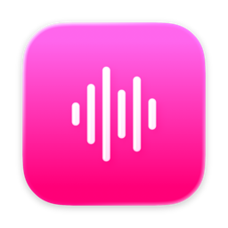

<h1 align="center">MusicBridge</h1>

Your Apple Music, on Discord. A native macOS app for sharing what you are listening to.

<a href="https://github.com/shmurky/MusicBridge/releases/download/v0.3.0/MusicBridge-0.3.0-universal.dmg"><strong>Download for Mac</strong></a> · <a href="https://github.com/shmurky/MusicBridge/releases">All releases</a> · <a href="https://github.com/shmurky/MusicBridge/issues">Report an issue</a>

## What it does

MusicBridge connects the Music app on your Mac to Discord Rich Presence. Play a song and your profile shows the track, artist, matching album artwork, and playback progress.

- **Make it yours.** Show the song title, artist, or “Apple Music” after “Listening to”.
- **Album artwork.** Matching covers from Apple's catalog, with a link to open the song in Apple Music.
- **Pause to hide.** Your activity clears after you pause, stop playback, or close Music.
- **Always nearby.** A native menu bar panel, a sharing switch, and optional launch at login.
- **Automatic reconnect.** MusicBridge reconnects when Discord becomes available again.
- **No Discord account token.** Setup uses an Application ID, not a password or bot token.

## Install

1. Download **MusicBridge-0.3.0-universal.dmg** from [Releases](https://github.com/shmurky/MusicBridge/releases).
2. Open the disk image and drag **MusicBridge** into **Applications**.
3. Eject the disk image, then open MusicBridge from Applications.

**Preview release:** this build is signed ad hoc and is **not notarized by Apple**. macOS may block it because the developer is not verified. If you need a verified installer, wait for a future Developer ID-signed, notarized release. Do not disable Gatekeeper globally.

**Requirements:** macOS 13 or later, the desktop Discord app, and playback in the macOS Music app. The download includes Apple Silicon and Intel binaries. Tested on Apple Silicon; Intel is cross-compiled and has not been tested on Intel hardware.

## Set up Discord

1. Open the [Discord Developer Portal](https://discord.com/developers/applications).
2. Choose **New Application**, enter a name, and create it.
3. Copy the **Application ID** from **General Information**.
4. Paste it into MusicBridge and click **Save**.
5. Turn on **Share music on Discord**.
6. Open Discord, play a song in Music, and allow MusicBridge to access Music when macOS asks.
7. Make sure activity sharing is enabled in Discord's activity privacy settings.

Choose **Song title**, **Artist**, or **Apple Music** in **Listening status** to change your presence text. MusicBridge checks playback every five seconds, so changes are not instant.

## Troubleshooting

**No activity on Discord?** Keep the desktop Discord app open, verify your Application ID, enable sharing in MusicBridge, and check Discord's activity privacy settings.

**Music access was denied?** Open **System Settings → Privacy & Security → Automation** and allow MusicBridge to access Music.

**No album cover?** Artwork requires an internet connection and a matching title, artist, and album in Apple's catalog. Local-only releases and different metadata may not match. Text activity still works without a cover.

**Music is playing on my iPhone.** MusicBridge currently reads playback on the Mac where it is running.

**Updating?** Quit MusicBridge, replace the app in Applications with the new download, and reopen it. Your saved settings stay on your Mac.

## Privacy

MusicBridge stores settings locally and does not record listening history or send data to a MusicBridge server. It sends the current title and artist to Apple's public iTunes Search API to find matching artwork, and passes activity information to the local Discord client. Apple hosts the artwork; Discord shares the activity according to your account settings. See [PRIVACY.md](PRIVACY.md).

## About this repository

This is the public home for MusicBridge downloads, documentation, and issue reports. The application source code is private and is not included here.

Download the **`.dmg` file** under Releases. GitHub also automatically adds “Source code” archives: those contain only this public repository's documentation, not the application or its private source code.

MusicBridge is an independent app and is not affiliated with or endorsed by Apple or Discord. It was built independently and does not redistribute the Music Presence application.

MusicBridge also reads embedded artwork directly from the Music app for its local preview. This artwork is kept in memory and is not uploaded. Discord artwork still requires a matching public image URL; local-only covers are not shared automatically. Catalog matches trigger an immediate refresh instead of waiting for the next five-second poll.
